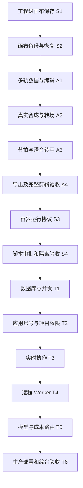

# AFDS 剪辑、团队部署与执行隔离实施计划

> 执行代理逐项使用 `superpowers:executing-plans` 实施，各子计划以复选框跟踪进度。本文为规划交付，任务状态以实际开发及验收证据更新。

## 目标

完成高级剪辑、团队产品化、工程级画布保存和外部脚本隔离，让现有个人本机制作流程逐步扩展到团队协作与远程执行。

## 架构

以 APR、Project Engine、持久任务队列和独立 Worker 为基础扩展。影片内容与画布布局分别维护修订，授权、事件与任务共享数据库事务。用户已于 2026-11-16 确认计划，采用 Windows 本机运行加 Linux/Docker 团队部署，进入逐项实施。

## 技术栈

沿用 FastAPI、Pydantic、SQLAlchemy 2.0、Alembic、React、TypeScript、React Flow、FFmpeg 和原生 OpenTimelineIO。团队运行增加 PostgreSQL 与容器部署，脚本隔离采用 Linux 容器。新增依赖在所属任务中锁定经测试的版本。

## 需求依据

原始设计的成功标准、总体架构、时间轴、权限和 Phase 6–7，以及用户于 2026-11-16 明确要求完善的三部分，共同构成本计划的需求范围。[原始设计](../../SPEC.md)

现有基线为应用 0.7.0、APR 0.4.0、Alembic 0007、提交 `995b95b`。最近一次已记录验收为后端 275 项通过、4 项跳过，前端 51 项通过，浏览器 8 项通过。该记录用于回归基线，本计划的新增能力分别建立新的验收证据。[交付记录](../../PROGRESS.md)

## 方案选择与假设

| 方案 | 实现影响 | 本计划采用方式 |
| --- | --- | --- |
| Windows 本机加 Linux/Docker 团队版 | 可复用 Linux 容器执行边界，团队使用 PostgreSQL，保留现有本机入口 | 用户已确认 |
| 全套原生 Windows | 需要额外设计原生隔离运行器与 Windows 部署矩阵 | 用户选择此方案时重写隔离与部署任务 |

以下具体数值采用本计划的默认值，包括视频轨数量、容器资源和协作目标，通过实施与验收记录验证。当前用户没有真实服务凭据。实施时已启动本机 Linux Docker 引擎。

## 全局约束

- APR 独立于模型、供应商私有参数及对话历史。
- 外部输入经过 Pydantic 校验，工程修改经过 Project Engine 事务和修订检查。
- 新数据库结构使用 Alembic，APR 结构升级提供旧版本装载路径。
- API 提交持久任务，媒体、分析、转写及导出由独立 Worker 执行。
- 生成素材保持不可变，下载经过项目权限、存储根目录和哈希检查。
- 局部修改复用无关素材，批准与锁定镜头继续参与影响分析和审批。
- 模型请求保留隐私授权、预算预留、连接版本和请求指纹，真实调用在用户配置并授权后验收。
- 脚本每次运行固定来源、参数、上下文、运行策略和镜像身份，并保留启动不确定状态的恢复规则。
- 每个里程碑提供 UI 入口、失败反馈、迁移或兼容行为、测试和文档。
- 工具认证、全局钩子和本机私有凭据配置由原有权限边界管理。团队账号作为 AFDS 应用功能实现。

## 需要重点验证的五类情况

1. 旧工程缺少新字段，以及 ZIP 恢复重新分配 ID 后的画布、转场和素材引用。由 S1、S2、A1、A4 覆盖。
2. 两个客户端同时编辑同一对象、断线重连及撤销时已有他人修改。由 S1、T1、T3 覆盖。
3. 多 Worker 并发领取、租约过期、远端提交结果未知及预算竞争。由 T1、T4、T5 覆盖。
4. 转场重叠、分数帧率、素材尾部、音画时长及字幕边界。由 A1、A2、A3、A4 覆盖。
5. 越权读取、脚本路径穿越、资源耗尽、策略变更及容器启动中断。由 S3、S4、T2、T6 覆盖。

## 子计划与文件责任

| 子计划 | 负责范围 | 任务 |
| --- | --- | --- |
| [画布持久化与脚本沙箱](2026-11-16-workspace-sandbox.md) | 独立画布修订、可移植工程、容器执行协议与运行审批 | S1–S4 |
| [高级剪辑与音频分析](2026-11-16-editing-audio.md) | 多视频轨、画中画、转场、节拍、转写与真实媒体验收 | A1–A4 |
| [团队协作与生产部署](2026-11-16-team-deployment.md) | PostgreSQL、应用账号、权限、实时同步、远程 Worker、模型路由与部署 | T1–T6 |

每个子计划列出具体新增及修改文件。核心文件采取定点扩展，新增模块按职责拆分，避免将新功能集中到 `App.tsx`、`api.py` 或 `worker.py`。

## 执行顺序与里程碑



| 里程碑 | 可交付结果 | 完成证据 |
| --- | --- | --- |
| M1 | 换浏览器继续编辑画布，工程包恢复布局与引用 | 两个独立浏览器上下文与恢复后的引用断言 |
| M2 | 多视频轨、画中画、转场、节拍与转写候选进入正常工作流 | 真实 MP4、像素/帧数/音轨检查、审批及浏览器操作 |
| M3 | 外部脚本在选定镜像与受限容器中执行 | 文件、网络、资源、取消及崩溃恢复的真实容器测试 |
| M4 | 成员登录后按项目权限协作编辑 | 角色矩阵、双客户端同步、冲突与撤销验证 |
| M5 | 多节点执行、预算约束模型选择及可部署团队版 | PostgreSQL 竞争测试、独立 Worker 节点、干净环境部署恢复 |

## 跨计划接口约定

- S1 定义 `WorkspaceDocument`、`WorkspaceSnapshot` 和 `WorkspaceService`。画布共享内容以 `workspace_revision` 管理，影片内容继续以 APR `revision` 管理。
- S2 为工程包增加版本化 `workspace.json` 与校验信息，恢复复用实体 ID 映射。A4 扩展同一导出版本以携带多轨与转场。
- A1 定义 `CompositionSpec` 和 `CompositionUpdateV2`。后续渲染、预览、转写应用、导出共同消费规范化合成描述。
- S3 定义 `ScriptExecutionPolicy` 与 `SandboxResult`，S4 在既有脚本方案中固定其摘要。T4 依据此策略匹配 Worker 能力。
- T2 定义 `Principal` 和 `require_project_access()`，T3 的事件、S1 的画布、T4 的节点管理及 T5 的路由配置使用同一权限入口。
- T5 定义 `RouteDecision`。它固定连接版本、估算依据和候选理由，并在入队事务中完成预算预留。

## 验证执行

任务内先添加针对新行为的回归测试，观察其失败，再实现并执行该任务的定向测试。提交时精确选择所属源文件、测试和文档，保留生成媒体及运行数据的本地管理方式。

每个里程碑执行后端 pytest、Ruff、前端 ESLint、Vitest、TypeScript/Vite 和 Playwright。主机命令以仓库现有工具为准，示例从仓库根目录执行。

```powershell
.venv/Scripts/python.exe -m pytest backend/tests -q --basetemp data/product-milestone-tests
.venv/Scripts/ruff.exe check backend scripts
.venv/Scripts/ruff.exe format --check backend scripts
npm --prefix frontend run lint
npm --prefix frontend test
npm --prefix frontend run build
```

浏览器测试从 `frontend` 执行，当前主机使用已安装的完整 Chromium。

```powershell
$env:PLAYWRIGHT_BROWSERS_PATH = 'D:/demo/AFDS/.cache/playwright'
npm exec -- playwright test --config ../.ai/phase7-playwright.config.ts
```

容器与 PostgreSQL 测试分别建立 `integration_docker`、`integration_postgres` 标记和隔离数据目录。对应里程碑保存实际通过证据。缺少 Docker 引擎、数据库或真实模型凭据的测试显示缺失原因，并在交付记录中列为待验收。

## 综合验收场景

1. 打开旧版工程，迁移画布并增加便签、连线，换浏览器验证保存结果。
2. 完成四镜头主轨，加入两个画中画片段、两种转场、配音和音乐。
3. 检测节拍，提交转写任务，审阅并批准字幕候选，验证手工字幕保护。
4. 两名成员同时编辑不同节点，再编辑同一节点，验证同步、冲突恢复与操作级撤销。
5. 运行受限脚本，验证主机文件访问、出站网络、资源上限、超时和结果下载。
6. 两个独立 Worker 领取任务，终止其中一个，验证租约、结果提交和远端任务恢复。
7. 在预算内选择合格模型，模拟超时和结果未知，核对计费任务的幂等与预留。
8. 渲染 MP4，通过 ffprobe 和抽帧确认画中画、转场、字幕及音轨，导出并恢复工程，再次渲染核对。
9. 从干净 Linux 部署启动团队版，重启服务并从备份恢复，核对成员权限与素材访问。

## 交付更新

每个里程碑更新 README、API/使用说明、`docs/PROGRESS.md` 和 `.ai/`，记录已实现范围、执行环境、通过证据和待验收项目。应用、APR、工程包与迁移版本在对应能力实际交付时更新。公开源码发布沿用已授权的源码范围，并单独核对远端路径和文件内容。

## 自查结果

- 用户提出的三部分均对应任务及验收场景，画布保存安排在协作之前。
- 所有跨计划类型和方法由所属任务定义，后续任务引用同一接口。
- 五类重点情况已分配测试任务，环境依赖在各里程碑单独呈现。
- 子计划复选框随实际实施与验收更新，执行证据记录在 PROGRESS 和项目内存中。

